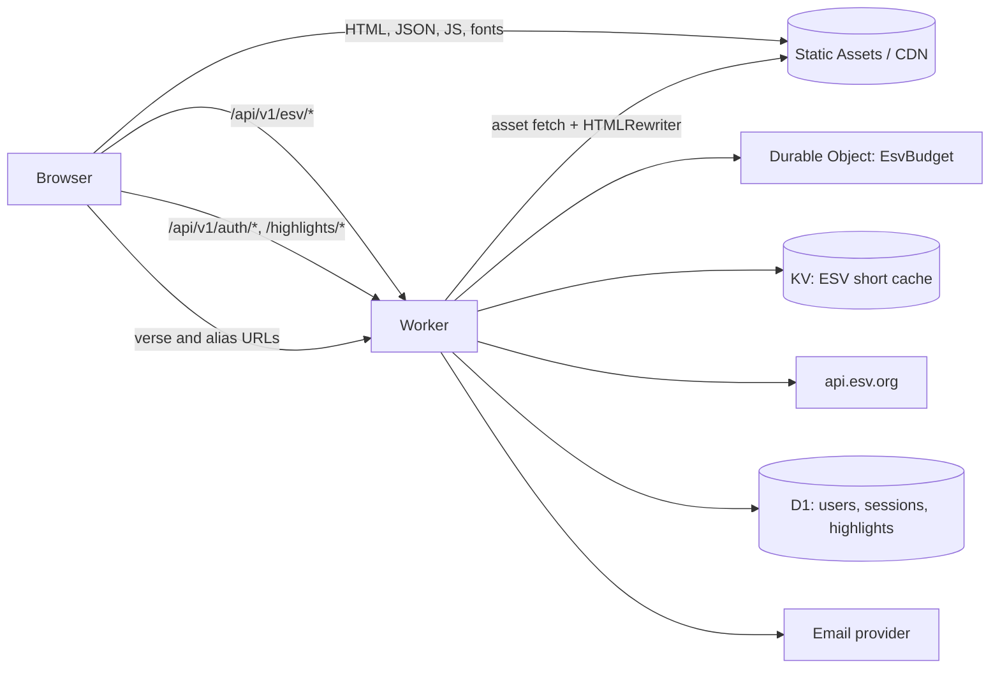
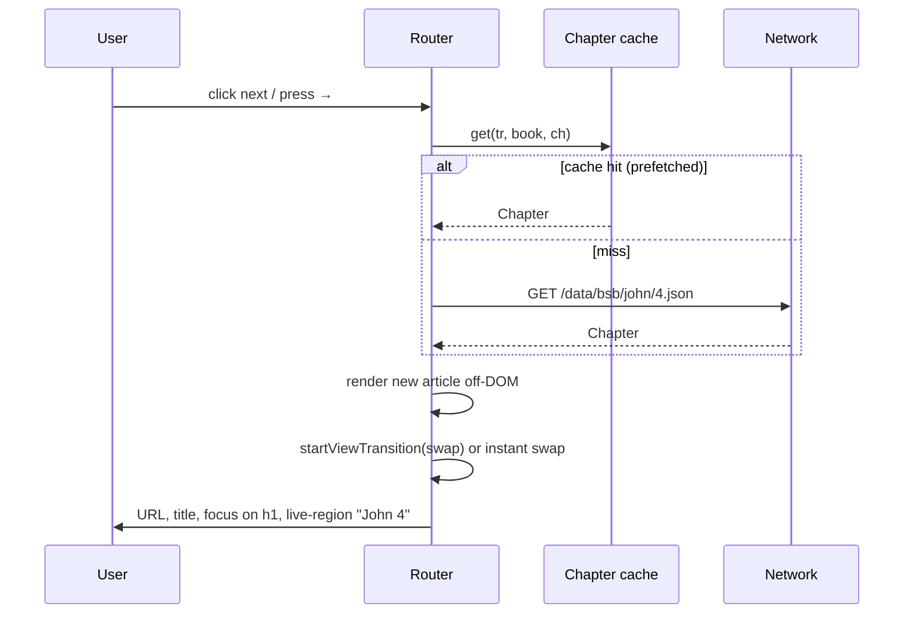
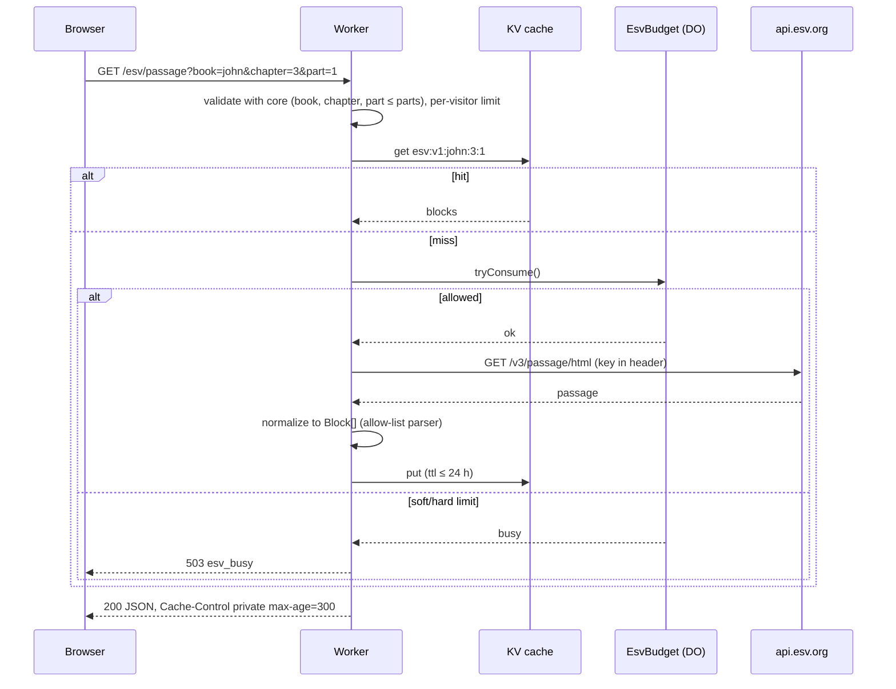
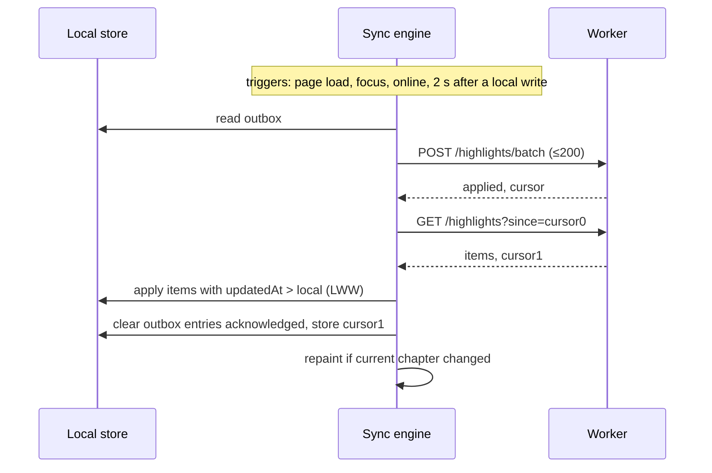

# Design: A Quiet Bible (working title) — MVP

Source requirements: `/Users/joshv/repos/tolle/SPEC.md` (approved). Requirement IDs (R1, N3, P2, S5, H4, T5, A3, …) refer to that file.
Assumptions are marked **[A]**. Items to prove early are marked **[SPIKE]** and are scheduled in M0.
Open questions in SPEC section 14 are resolved here with the defaults stated there.

---

## 1. Overview

A static-first Bible reader. Public-domain text (BSB, KJV, WEB) is pre-rendered to HTML and JSON and served from a CDN. A small Worker adds three things: an ESV proxy, optional accounts, and highlight sync. Everything a reader does without an account runs in the browser.

### Design drivers
| Driver | Consequence |
|---|---|
| Fast (principle 3, LCP ≤ 1.0 s, JS ≤ 60 KB gz) | Static HTML per chapter, tiny islands, no SPA framework runtime for the reading view, prefetch next/prev |
| Just the text (principle 1) | One chrome bar, one column, one popover system; no panels |
| ESV terms (SPEC 8.1) | ESV is never static, never in SW/IndexedDB/sync/search, always paged by the half-book rule, always budgeted |
| Phases 2 and 3 | Platform-neutral core (`packages/core`), versioned HTTP API with OpenAPI, shared test vectors, same chapter JSON for web and iOS |
| Minimal data | Server stores email + (verse, color, timestamp). No history, no IP logs |

### Decisions that differ from, or sharpen, the SPEC
| # | Decision | Reason |
|---|---|---|
| D1 | **Cloudflare Workers with Static Assets** instead of Cloudflare Pages | Same vendor; one deployable; static asset hits are served without invoking the Worker, the Worker runs only on paths with no asset (API, verse URLs, aliases) **[SPIKE: confirm billing and routing behavior]** |
| D2 | **Verse URLs are not pre-built.** `/bsb/john/3/16` is served by the Worker, which rewrites the chapter HTML's metadata | 31,102 verses × 3 translations ≈ 93k files is wasteful; chapter HTML already contains the verse |
| D3 | Highlights keyed by integer `verse_id` (e.g. `43003016`), no client UUID | The composite key is the identity; smaller, sortable, trivial to port to Swift |
| D4 | Magic link opens `/auth/verify#token=…`; the page `POST`s the token | Mail scanners that prefetch links cannot consume a token on `GET` |
| D5 | ESV proxy takes structured params (`book`, `chapter`, `part`) not free text `q` | Cache-friendly, no injection surface, page windows computed once in shared code |
| D6 | ESV pages are an app shell that fetches the passage client-side, with `<meta name="robots" content="noindex">` **[A]** | Honors "no pre-render" and avoids indexing licensed text; revisit after Crossway confirms |
| D7 | Dark `--text-tertiary` becomes `#808080` | `#7A7A7A` on `#0F0F0F` is ≈ 4.47:1, below AA 4.5:1. `#808080` is ≈ 4.9:1 |

---

## 2. Architecture



### Request routing
| Path | Served by | Notes |
|---|---|---|
| `/{tr}/{book}/{chapter}` for `bsb`, `kjv`, `web` | Static asset | 3 × 1,189 pages |
| `/esv/{book}/{chapter}` | Static shell asset (rewrite) | Same HTML for every ESV chapter; client fetches text |
| `/{tr}/{book}/{chapter}/{verses}` | Worker | Fetches the chapter asset, rewrites `<title>`, description, canonical, OG, breadcrumb |
| `/{book}/{chapter}`, `/{tr}/{alias}/{chapter}` | Worker | 301 to canonical slug and default translation |
| `/`, `/about`, `/privacy`, `/search` | Static asset | `/` is a copy of BSB John 1 with an inline redirect for returning users |
| `/data/{tr}/…` | Static asset | Chapter JSON, search index |
| `/api/v1/*` | Worker | JSON only |

Worker routing uses one function, `resolveRoute(path)`, from `packages/core`. The same function drives client-side navigation, so server and client never disagree about a URL.

### Repository layout (pnpm workspace)
```
tolle/
  SPEC.md  design.md
  apps/
    web/            Astro site, islands (TypeScript), service worker, CSS tokens
    worker/         Worker (Hono), Durable Object, D1 migrations, wrangler.jsonc
  packages/
    core/           Pure TS, no DOM: books, parser, route, versification, verse ids,
                    ESV windowing, block types, plain-text extraction. Shared by web + worker + build
    render/         Isomorphic chapter renderer (Block[] → HTML string)
    api-spec/       openapi.yaml + generated types
  scripts/          build-data.ts (USFM → chapter JSON, validation, search index)
  data/sources/     Raw public-domain USFM + SOURCES.md (checksums, URLs, versions)
  test-vectors/     JSON fixtures shared with the future iOS app
```
Generated output (`apps/web/public/data`, `dist`) is git-ignored. Exact dependency versions are pinned in the lockfile and `package.json` at M0.

### Technology choices
| Concern | Choice | Notes |
|---|---|---|
| Site generator | Astro (static output) | Zero JS by default; islands only where needed |
| Islands | Vanilla TypeScript modules; Svelte only if a component's state gets complex **[A]** | Keeps first-load JS in budget |
| Worker framework | Hono | Small, typed routing, runs on Workers |
| DB | D1 (SQLite) | Users, sessions, highlights |
| ESV budget/limits | One Durable Object (`EsvBudget`) | Atomic counters across all isolates |
| ESV cache | Workers KV with `expirationTtl ≤ 86400` | Global; eventual consistency is fine for a cache |
| Email | Resend or Postmark over HTTPS **[A]** | Sending domain with SPF, DKIM, DMARC |
| Tests | Vitest (+ Workers pool), Playwright, axe-core, Lighthouse CI, size-limit | |
| Fonts | Source Serif 4 (reading), Inter (UI), self-hosted WOFF2, Latin subset | OFL |

---

## 3. Components and interfaces

### 3.1 `packages/core`

**Books** (`books.ts`, generated from `books.json`)
```ts
type BookId = 'genesis' | /* … 66 … */ 'revelation'
interface Book {
  id: BookId; slug: string            // 'song-of-solomon'
  name: string; short: string         // 'Song of Solomon', 'Song'
  testament: 'ot' | 'nt'; order: number   // 1..66
  chapters: number
  verses: number[]                    // verse count per chapter, index 0 = chapter 1
  aliases: string[]                   // normalized: 'sos', 'songofsongs', 'cant'
}
```
`verseCount(book)` = sum of `verses`. Counts follow the KJV/Protestant canonical versification.

**Verse ID** (`verseId.ts`)
```ts
// bookOrder*1_000_000 + chapter*1_000 + verse     43003016 = John 3:16
encodeVerseId(book: BookId, ch: number, v: number): number
decodeVerseId(id: number): { book: BookId; chapter: number; verse: number }
```

**Reference parser** (`parse.ts`)
```ts
type Ref = { book: BookId; chapter: number; vStart?: number; vEnd?: number }
type ParseResult =
  | { kind: 'ref'; ref: Ref; label: string }                 // 'Romans 8:28'
  | { kind: 'ambiguous'; candidates: { book: BookId; ref: Ref; label: string }[] }  // ≤ 3
  | { kind: 'invalid'; reason: 'chapter_out_of_range' | 'verse_out_of_range';
      book: BookId; max: number; suggestion: Ref }           // 'Genesis has 50 chapters'
  | { kind: 'search'; query: string }
parseInput(input: string): ParseResult
```
Algorithm (pure, no I/O):
1. **Normalize.** NFKC, lowercase, trim, replace `–—‒` with `-`, replace `.` and `,` between digits and `:` with `:`-equivalent separators, collapse whitespace. Keep `;` for the "ignore the rest" rule.
2. **Split** at the first `;` and drop the remainder **[A: multi-range is Could]**.
3. **Tokenise** into an optional leading ordinal (`1`, `2`, `3`, `i`, `ii`, `iii`, `first`, `second`, `third`, `1st`…), a book word run, and a numeric tail. A digit glued to a word (`john3`, `1cor13`) is split.
4. **Resolve the book.** Alias key = word run with spaces and dots removed, plus the ordinal as a digit. Lookup order: exact alias, then unique prefix of ≥ 2 characters over all aliases, then multiple prefix matches → `ambiguous` (rank: exact-prefix of canonical name, then a small popularity prior; max 3).
5. **Parse the tail** with `^(\d+)(?:[:\s.](\d+)(?:-(\d+)?)?)?$` style rules:
   - one number on a multi-chapter book → chapter; on a single-chapter book (Obadiah, Philemon, 2 John, 3 John, Jude) → verse of chapter 1.
   - `c:v`, `c v`, `c.v` → chapter and verse; `c:v1-v2` → range; trailing `-` → single verse.
   - no tail → chapter 1.
6. **Validate** against `book.verses`. Out of range → `invalid` with a clamped `suggestion`.
7. **Search fallback.** If step 4 finds no book, or the tail does not match, return `search`. Exception: a lone word that is a book name (`mark`, `job`, `acts`) resolves as a reference. The reference bar shows a second suggestion row "Search for “mark”" (see 3.4); `Cmd/Ctrl+Enter` always searches.

Test vectors live in `test-vectors/refs.json` (≥ 300 cases, includes every row in SPEC 5.3). The same file is the contract for a future Swift port.

**Route** (`route.ts`)
```ts
type Route =
  | { kind: 'chapter'; tr: Translation; book: BookId; chapter: number; part?: number }
  | { kind: 'verses';  tr: Translation; ref: Ref }
  | { kind: 'redirect'; to: string; status: 301 | 302 }
  | { kind: 'search' | 'static' | 'notfound' }
resolveRoute(pathname: string, search: URLSearchParams): Route
formatPath(tr: Translation, ref: Ref): string     // '/bsb/1-corinthians/13/4-7'
```

**Versification** (`versification.ts`)
```ts
// Maps a translation's (chapter, verse) to canonical verse IDs and back.
toCanonical(tr: Translation, book: BookId, ch: number, v: number): number[]
fromCanonical(tr: Translation, id: number): { ch: number; v: number } | null
```
Default is identity. `data/versemap/{tr}.json` lists only exceptions found by the build validator (section 6.2). Omitted verses in modern texts (for example, ESV has no Matthew 17:21) keep their numbers; they are simply absent.

**ESV windowing** (`esvWindows.ts`)
```ts
// max verses per displayed page = min(500, floor(bookVerseCount / 2))
esvWindows(book: BookId, chapter: number): { part: number; vStart: number; vEnd: number }[]
```
The chapter is split into the fewest windows that fit the cap, with sizes balanced: `n = ceil(verses / cap)`, `size = ceil(verses / n)`. Examples: Jude (25 verses, cap 12) → 9, 9, 7. 3 John (14, cap 7) → 7, 7. Haggai 2 (23 verses, book 38 → cap 19) → 12, 11. Most chapters have one window.
Invariants (unit-tested over all 1,189 chapters): windows cover every verse once; no window exceeds the cap; windows are contiguous.

### 3.2 Content model (`packages/core/types.ts`)

```ts
type Item =
  | string                         // plain text
  | { v: number }                  // verse starts here
  | { nd: string }                 // divine name, rendered in small caps (LORD)
  | { fn: number }                 // footnote marker, index into chapter.notes
type Line  = { i: 0 | 1 | 2 | 3; items: Item[] }       // poetry line with indent level
type Block =
  | { t: 'h'; text: string }                            // section heading
  | { t: 'd'; items: Item[] }                           // psalm title, unnumbered
  | { t: 'p'; items: Item[] }                           // prose paragraph
  | { t: 'q'; lines: Line[] }                           // poetry stanza
interface Chapter {
  tr: Translation; book: BookId; chapter: number
  blocks: Block[]
  notes?: string[]                                      // footnotes (R4), optional
  range?: [number, number]                              // ESV window
  parts?: number; part?: number                         // ESV paging
}
```
Notes:
- A verse that crosses lines or blocks appears as multiple DOM fragments carrying the same `data-v`. Highlighting, focus and copy work on `data-v`, not on one element.
- `plainVerses(chapter): Map<number,string>` flattens items to text. Search indexing, copy and ARIA labels use it.
- No red-letter data is kept (R3).

### 3.3 `packages/render`

`renderChapter(chapter, opts): string` returns the article HTML. It runs at build time (Astro) and in the browser (client navigation and ESV), so there is one renderer.

```html
<article class="chapter" lang="en" data-tr="bsb" data-book="john" data-ch="3">
  <h2 class="sec">The New Birth</h2>
  <p>
    <span class="v" data-v="1"><sup class="vn">1</sup>Now there was a Pharisee…</span>
    <span class="v" data-v="2"><sup class="vn">2</sup>…</span>
  </p>
  <div class="poetry"><p class="l i1"><span class="v" data-v="9">…</span></p></div>
</article>
```
- `.vn` has `user-select: none` and is `aria-hidden="false"` with visible numerals so screen readers announce verse numbers.
- The page `<h1>` is the picker button (3.5), outside `<article>`.
- All text is escaped by the renderer; ESV text passes through the same path. The ESV normalizer never forwards raw HTML.

### 3.4 Reference bar (island: `refbar.ts`)

- Markup: `<input role="combobox" aria-expanded aria-controls="refbar-list" aria-autocomplete="list" aria-activedescendant>` and a `<ul role="listbox">` of at most 3 rows. Idle value is the current reference label.
- State machine: `idle → focused(selectAll) → typing(parse on every input) → submit | cancel`.
- On each input: `parseInput()` (sync, < 1 ms). Render the first row as the suggestion, faint and inline. If the result is `ambiguous`, rows are the candidates. If a book-name match could also be a word search, row 2 is "Search for “…”". `invalid` renders an inline message with a one-click suggestion.
- `Enter`: first row. `ArrowUp/Down`: move through rows. `Esc`: restore the label and blur. `Cmd/Ctrl+Enter`: force search.
- Submit navigates through the router (3.8). Search submits go to `/search?q=…&t=…`.
- Width animates 360 → 520 px on focus (transform-free: `inline-size` with 150 ms ease-out; reduced-motion: none).

### 3.5 Book/chapter picker (island: `picker.ts`)

- Trigger: the `<h1>` contains a `<button aria-haspopup="dialog" aria-expanded>` "John 3 ▾".
- Panel: a Popover API element (`popover="auto"`) anchored below the heading, 640 px wide, light dismiss and `Esc` for free. Focus is managed by hand because popover does not move focus.
- View A (books): two columns, 39 and 27 buttons, grouped under "Old Testament" and "New Testament" headings, 32 px rows. Buttons are real `<button>`s in a CSS grid, so Tab order is natural; arrow keys are a roving-tabindex enhancement.
- View B (chapters): back button + book name + a grid of chapter numbers (6 columns). The view swap is a 150 ms cross-slide (opacity + 8 px translate). Current book is bold; current chapter is filled (N4).
- Type-ahead: printable keys feed a 700 ms buffer matched with the parser's alias prefix rules; matches focus the first row. Digits in View B jump to a chapter; `Enter` selects.
- Data is inlined at build time in the HTML (about 2 KB of button markup, `hidden` until opened) so opening needs no network and no render pass (N7). **[A]** If the inline markup costs LCP, move it to a `<template>` and clone on first open.
- On select: router navigation; popover closes; focus moves to the new `<h1>` button.

### 3.6 Keyboard dispatcher (`keys.ts`)

One `keydown` listener on `document`. A key is ignored when: `event.isComposing`, any of Ctrl/Meta/Alt is down (except the listed combos), the target is an input, textarea, select or contenteditable, or an open popover owns the key. Bindings are data (`{ key, when, run }`), also used to render the `?` popover, so documentation cannot drift.

| Key | Handler |
|---|---|
| `/`, `Cmd/Ctrl+L` | `refbar.focus()` (`preventDefault` only for `/`; `Cmd+L` is left to the browser address bar if the page does not capture it **[A]**: bind it, because the SPEC asks for it, and accept the override) |
| `B` | open picker |
| `←` / `→` | previous / next chapter, only when there is no text selection and focus is on `body` or the article |
| `T`, `D`, `?`, `Esc` | translation switcher, theme toggle, shortcut list, close/clear |
| `1`–`4`, `0`, `Cmd/Ctrl+Z` | highlight actions (only while a verse selection exists / for undo) |

### 3.7 Translation switcher (`translations.ts`)
A small button "BSB ▾" opening a 4-item popover. Switching computes `formatPath(newTr, currentRef)` and navigates, preserving the focused verse via the URL; scroll position is restored by scrolling the same `data-v` into the same viewport offset (stored in `history.state` before navigation, applied after render). Switching to ESV when the page is outside its windows lands on the window containing the verse.

### 3.8 Router (`router.ts`)
A tiny History-API router, loaded in the first-load bundle.


- Same-origin link clicks matching `resolveRoute` as `chapter` or `verses` are intercepted; modified clicks and non-matching links fall through to normal navigation.
- Old content stays on screen until the new article is ready. If a PD chapter takes > 200 ms, nothing changes visually (no spinner over text). ESV waits show a skeleton after 200 ms.
- Prefetch: on idle after load and on hover/focus of prev/next, fetch the adjacent PD chapters (`<link rel=prefetch>` for the first, `fetch` thereafter). **ESV is never prefetched** (SPEC 8.1).
- LRU cache of the last 20 PD chapters in memory. ESV chapters are cached only in a module-scoped variable for the current page (back/forward re-fetches through the Worker).
- A failed fetch falls back to full-page navigation, so the user is never stuck.
- Scroll resets to top on forward navigation; popstate restores `history.state.scrollY`.
- Focus management and an `aria-live="polite"` region announce chapter changes.

### 3.9 Theme and settings (`settings.ts`)
- Inline `<script>` in `<head>` (hash-allowed in CSP) reads `localStorage.theme` and sets `document.documentElement.dataset.theme` before first paint. It also applies text size and font to avoid reflow.
- Settings object `{ theme, size: 0..4, font: 'serif'|'sans', width: 'narrow'|'default', headings: boolean, autohide: boolean }` in `localStorage` (`quiet.settings.v1`), applied via data attributes and CSS variables. A single "Aa" popover edits it.
- Chrome auto-hide: scroll direction observed in a passive `scroll` listener with `requestAnimationFrame`; the bar moves with `transform: translateY(-100%)`. It reappears on scroll-up, pointer within 48 px of the top, or any focus inside it.

### 3.10 Highlights (island: `highlights/`, loaded on first selection or on idle)

Modules: `store.ts` (IndexedDB), `selection.ts`, `toolbar.ts`, `paint.ts`, `history.ts`, `sync.ts`.

**Store.** IndexedDB database `quiet` v1.
| Object store | Key | Value |
|---|---|---|
| `highlights` | `verseId` (number) | `{ color, updatedAt, deleted }` |
| `outbox` | `verseId` | `{ color \| null, updatedAt }` (latest intent per verse) |
| `meta` | string | `cursor`, `lastSyncAt`, `userId` |
Fallback if IndexedDB is unavailable (some private modes): in-memory map persisted to `localStorage` with a quiet one-line notice in settings. Multi-tab consistency via `BroadcastChannel('quiet-highlights')`; each tab repaints on message.

**Selection → verses.**
1. `selectionchange` (debounced 30 ms) and `pointerup`/`keyup` read `getSelection()`.
2. For `range.startContainer` and `endContainer`, take `closest('[data-v]')`; the selected verse set is every `data-v` between them in document order within `<article>`. Selections that touch no verse are ignored.
3. Verse-number click: click `.vn` selects its verse; `Shift`+click extends from the anchor verse; a second plain click on the only selected verse clears it. This path does not rely on text selection, so it is the robust fallback (risk 7).
4. Keyboard: verses are focusable via `Tab` into the article, then `ArrowUp/Down` moves a verse cursor, `Shift+Arrow` extends; the same selection model feeds the toolbar and the `1`–`4`/`0` keys. Keyboard users get an `aria-live` message "Verses 16 to 18 selected".

**Toolbar.** A 36 px fixed-position element (`role="toolbar"`, `aria-label="Highlight"`) with four `<button>` swatches (16 px dots, 28 px hit area, tooltips and `aria-label` "Sand", …) and a remove button, shown only when the selection includes a highlighted verse. Positioned from `range.getBoundingClientRect()`, 8 px above; flips below when there is no room; clamped to the viewport. It fades in 100 ms and is removed on `Esc`, scroll beyond the selection, or after applying.

**Apply/remove.** `applyColor(verseIds, color | null)`:
1. Read prior state for undo.
2. Write `highlights` (`updatedAt = Date.now()`, `deleted = color === null`) and `outbox` in one IndexedDB transaction.
3. Repaint affected `.v` fragments by setting `data-hl="sand"` (or removing it).
4. Push `{prior, next}` onto an in-memory undo stack (cap 50). `Cmd/Ctrl+Z` pops and applies the inverse as a new write (new timestamp), so sync stays monotonic.
5. Schedule sync (debounced 2 s) if signed in.

**Paint.** CSS only: `.v[data-hl="sand"] { background: var(--hl-sand); }` with `box-decoration-break: clone; -webkit-box-decoration-break: clone;` so wrapped lines are covered evenly. On chapter render, `paint(chapter)` reads all `highlights` rows in the chapter's ID range with one IndexedDB range query. For versification differences, `toCanonical` converts each rendered verse to canonical IDs. The screen-reader state is a visually hidden "highlighted" suffix element appended to the fragment.

**ESV (H6).** Highlight rows contain only `verseId`, color and timestamps. ESV text is never read into the store, the outbox, or sync payloads. A unit test asserts that stored values contain no string fields other than `color`.

**Export/import (H8).** `settings` → "Export highlights" downloads `quiet-highlights.json`: `{ version: 1, items: [{ verseId, color, updatedAt }] }`. Import merges by LWW and shows a one-line summary.

### 3.11 Search (island: `search/`)

- Index per PD translation built at build time with MiniSearch (fields: `text`; no stored fields; stemming via a small English stemmer; diacritics folded). The index is a versioned JSON file `/data/{tr}/search.v{hash}.json`, Brotli-compressed by the CDN **[SPIKE: must be ≤ 3 MB gz (S5). Fallback: custom inverted index with delta-varint postings, expected ≈ 1 MB gz]**.
- Runs in a **Web Worker** so typing and scrolling stay responsive. The worker loads the index on first use, then answers `{q, scope, page}` queries.
- Verse text for the results page comes from chapter JSON (already cached by the SW or prefetch). The page requests the ≤ 25 chapters it needs in parallel.
- Query semantics: AND of stemmed terms; `"quoted phrase"` is an AND query followed by an exact-phrase filter over the candidate verses' plain text (loaded in batches of 20 chapters until 25 results are filled). Scope filter (`ot`, `nt`, or a book) is a post-filter on `verseId`.
- Ranking: MiniSearch BM25 score, then canonical order for ties. Match emphasis uses `<mark>` styled as a soft underline/tint, not bright color.
- URL: `/search?q=love+your+enemies&t=bsb&scope=nt&page=2`. The page is a static shell plus the island.
- ESV search calls `/api/v1/esv/search` (3.12) and renders the same result rows, with the ESV notice at the bottom.
- Acceptance check in CI: query "love your enemies" returns Matthew 5:44 in the top 3 for BSB, KJV and WEB.

### 3.12 Worker API (`apps/worker`)

Hono app with middleware in this order: security headers → request-id (random, never logged with IP) → CORS (own origin only) → route.

**ESV proxy**
```
GET /api/v1/esv/passage?book=john&chapter=3&part=1
→ 200 { tr:'esv', book, chapter, part, parts, range:[1,36], blocks:[…], copyright:"…" }
GET /api/v1/esv/search?q=love&page=1
→ 200 { query, page, pages, results:[{ book, chapter, verse, text }], copyright }
errors: 400 bad_request · 429 rate_limited · 503 esv_busy | esv_unavailable
```
Passage flow:

- **Upstream request** (**[SPIKE]** confirm option names against the ESV API docs at M4): the HTML endpoint with passage references, footnotes and the short copyright turned off, headings and verse numbers on. The `Authorization: Token …` header is added in the Worker only.
- **Normalizer.** A small allow-list HTML tokenizer maps ESV markup to `Block[]` (headings, paragraphs, poetry indents, verse numbers). Unknown tags are dropped, text is kept. Output never contains raw HTML. Fixture tests cover prose, Psalms (titles, indents), Proverbs, a chapter with headings, Jude, and a chapter whose text has omitted verse numbers.
- **Windowing.** The Worker computes `esvWindows(book, chapter)`, requests only `range`, and rejects `part` outside `1..parts`. One upstream call never exceeds the cap.
- **Cache.** KV key `esv:v1:{book}:{chapter}:{part}`, `expirationTtl = 86400` (maximum). Each entry holds one window (≤ 500 verses by construction). No cache warming, no bulk fetch. Single-flight: concurrent misses for one key share one upstream call inside an isolate **[A]**.
- **Budget.** `EsvBudget` durable object keeps timestamps of upstream calls for the last 24 h (≤ 5,000 numbers) and exposes `tryConsume(kind)`.
  | State | Condition | Behavior |
  |---|---|---|
  | open | all windows below 80% of 60/min, 1,000/h, 5,000/day | miss allowed |
  | soft | any window ≥ 80% | cache-only: misses return `503 esv_busy`; search disabled |
  | hard | any window ≥ 95% | all upstream calls refused |
  Percentages leave headroom for clock skew and the API's own window definition **[A: confirm window semantics]**.
- **Per-visitor throttle.** Cloudflare's Workers rate-limiting binding, keyed by client IP, 20 requests/minute **[A]**; the IP is only a key held by the binding and is not written to our logs.
- **Client behavior on error.** `esv_busy` or `esv_unavailable` renders an inline note "ESV is unavailable right now." with a button "Read this chapter in BSB" (uses the verse mapping). No retry loop; one manual "Try again".

**Auth**
```
POST /api/v1/auth/request  { email }                    → 202 always (no account enumeration)
POST /api/v1/auth/verify   { token, client:'web'|'native' }
                           → 200 { user:{ id }, token? }   web: Set-Cookie; native: token in body
POST /api/v1/auth/signout                                → 204
GET  /api/v1/me                                          → { id, email }
DELETE /api/v1/account                                   → 204
GET  /api/v1/account/export                              → JSON
```
- `request`: normalize email (trim, lowercase), rate limit 5/hour per email and 20/hour per IP key, create a 32-byte random token, store `SHA-256(token)` with a 15-minute expiry, send a plain-text email with `https://host/auth/verify#token=…`. Fragment tokens are not sent to servers or logged by referrers.
- `verify`: single use; creates the user on first success; issues a 32-byte session token (store its hash). Web: cookie `__Host-session; HttpOnly; Secure; SameSite=Lax; Path=/; Max-Age=7776000`. Native: returns the token for Keychain storage and uses `Authorization: Bearer`.
- Session lifetime 90 days, extended when fewer than 30 days remain.
- State-changing requests require `Content-Type: application/json` and an `Origin` that matches the site (web), which together with `SameSite=Lax` covers CSRF.
- Deleting an account runs `DELETE FROM users` (cascade) and clears the cookie.

**Highlight sync**
```
GET  /api/v1/highlights?since=<cursor>
     → { items:[{ verseId, color|null, updatedAt }], cursor, reset:boolean }
POST /api/v1/highlights/batch  { items:[{ verseId, color|null, updatedAt }] }   (≤ 200)
     → { applied:number, cursor }
```
- `verseId`s are validated against `books.json` bounds. `color ∈ {sand,sage,slate,rose,null}`; `null` is a tombstone.
- `updatedAt` from the client is clamped to `[now − 366 d, now + 5 min]`.
- `reset: true` is returned when `since` is older than the tombstone horizon; the client then performs a full pull and keeps only local rows newer than the server's version of each verse.
- Responses carry `Cache-Control: no-store`.

**Metrics (optional)**: `POST /api/v1/metrics { name, bucket }` writes to Workers Analytics Engine with no user or IP fields; names are an allow-list (`lookup_ms`, `parse_fail`, `search_used`, `highlight_used`). **[A]** Core Web Vitals come from Cloudflare Web Analytics (cookieless).

### 3.13 Service worker (`sw.ts`)
- Precaches the versioned JS/CSS/fonts of the current build.
- Runtime cache (cache-first, 30-day expiry, size cap 200 entries) for `/data/*` public-domain JSON and search indexes only.
- Never touches `/api/*`, `/esv/*`, or anything with `Authorization`/cookies.
- Navigations are not cached in MVP (avoids stale HTML); offline reading arrives with the phase 2 PWA.
- Version-keyed cache names; old caches deleted on `activate`. A kill switch: if `/sw-kill.json` reports `{ disabled: true }`, the worker unregisters itself.

---

## 4. Data models

### 4.1 Static data (build output)
```
/data/books.json                         // generated from core, cached 1 y
/data/{tr}/{book}/{n}.json               // Chapter (3.2), ~5–20 KB each
/data/{tr}/search.v{hash}.json           // lazy search index
/{tr}/{book}/{n}/index.html              // pre-rendered chapter page
```
Chapter JSON uses short keys as shown in 3.2. All files are content-hashed or versioned in the path where they are long-cached; chapter HTML uses `Cache-Control: public, max-age=300, stale-while-revalidate=86400`.

### 4.2 D1 schema (`apps/worker/migrations/0001_init.sql`)
```sql
CREATE TABLE users (
  id          TEXT PRIMARY KEY,            -- random 128-bit, hex
  email       TEXT NOT NULL UNIQUE,        -- lowercase
  created_at  INTEGER NOT NULL,            -- unix seconds
  seq         INTEGER NOT NULL DEFAULT 0   -- per-user sync counter
);

CREATE TABLE login_tokens (
  token_hash  TEXT PRIMARY KEY,            -- sha-256 hex
  email       TEXT NOT NULL,
  expires_at  INTEGER NOT NULL,
  used_at     INTEGER
);

CREATE TABLE sessions (
  token_hash  TEXT PRIMARY KEY,
  user_id     TEXT NOT NULL REFERENCES users(id) ON DELETE CASCADE,
  kind        TEXT NOT NULL CHECK (kind IN ('web','native')),
  created_at  INTEGER NOT NULL,
  expires_at  INTEGER NOT NULL
);
CREATE INDEX sessions_user ON sessions(user_id);

CREATE TABLE highlights (
  user_id     TEXT NOT NULL REFERENCES users(id) ON DELETE CASCADE,
  verse_id    INTEGER NOT NULL,
  color       TEXT,                        -- NULL when deleted = 1
  updated_at  INTEGER NOT NULL,            -- unix ms, clamped
  deleted     INTEGER NOT NULL DEFAULT 0,
  seq         INTEGER NOT NULL,
  PRIMARY KEY (user_id, verse_id)
) WITHOUT ROWID;
CREATE INDEX highlights_seq ON highlights(user_id, seq);
```
Expired `login_tokens` and `sessions`, and tombstones older than 30 days, are removed by a daily Cron Trigger.

### 4.3 Sync semantics
- **Identity:** `(user_id, verse_id)`. **Conflict rule:** last write wins by `updated_at`; ties keep the existing row (deterministic).
- **Upsert** (one D1 `batch` = one transaction, so `seq` and rows commit together):
```sql
UPDATE users SET seq = seq + 1 WHERE id = ?1;
-- for each item:
INSERT INTO highlights (user_id, verse_id, color, updated_at, deleted, seq)
VALUES (?1, ?2, ?3, ?4, ?5, (SELECT seq FROM users WHERE id = ?1))
ON CONFLICT (user_id, verse_id) DO UPDATE SET
  color = excluded.color, updated_at = excluded.updated_at,
  deleted = excluded.deleted, seq = excluded.seq
WHERE excluded.updated_at > highlights.updated_at;
```
- **Cursor** = last `seq` the client has applied. `GET ?since=c` returns rows with `seq > c` (including tombstones) and the new maximum.


- **First sign-in merge (A3):** the engine treats all local `highlights` rows as outbox items, pushes them, then performs a full pull (`since=0`). LWW picks the newer side per verse. Nothing is lost on either side except by explicit newer deletes.
- **Offline (A6):** writes land in `highlights` and `outbox`; sync is retried with exponential backoff (2 s → 5 min) and on the `online` event.
- **Sign out (A7):** session deleted server-side; local rows stay; optional "also clear this device" wipes `highlights`, `outbox`, `meta`.
- **Backups:** D1 point-in-time recovery is the backup. Deleted accounts can remain in backups until the retention window ends; the privacy page says so plainly.

### 4.4 Local storage keys (device only, not synced)
`quiet.settings.v1`, `quiet.pos.v1` (`{ tr, book, chapter, verse? }`), `theme`. Reading position is written on `pagehide` and after a 1 s dwell on a chapter.

---

## 5. Design system

### 5.1 Tokens (`apps/web/src/styles/tokens.css`)
```css
:root {
  --bg: #fff; --surface: #fff; --text: #111; --text-2: #5c5c5c; --text-3: #767676;
  --border: #e8e8e8; --hover: #f5f5f5; --focus: #111;
  --hl-sand: #f1ebdd; --hl-sage: #e4ebe1; --hl-slate: #e3e8ee; --hl-rose: #f0e3e3;
  --measure: 680px; --step: 19px; --lh: 1.7;
  --ease: cubic-bezier(.2,.6,.2,1);
}
:root[data-theme="dark"] {
  --bg: #0f0f0f; --surface: #181818; --text: #ececec; --text-2: #a3a3a3; --text-3: #808080;
  --border: #262626; --hover: #1c1c1c; --focus: #ececec;
  --hl-sand: rgb(210 190 140 / .18); --hl-sage: rgb(150 180 150 / .18);
  --hl-slate: rgb(140 165 200 / .18); --hl-rose: rgb(200 150 150 / .18);
}
@media (prefers-color-scheme: dark) { :root:not([data-theme]) { /* same as dark */ } }
```
Values are the SPEC's, except `--text-3` (light `#767676`, dark `#808080`; D7). A unit test computes WCAG contrast for every text/background pair and every text-on-tint pair (tint alpha-blended over `--bg`) in both modes and fails below 4.5:1 (3:1 for large text and UI borders).

### 5.2 Typography and layout
- Reading column: `max-width: var(--measure)` centered; side padding `clamp(20px, 6vw, 48px)`; top bar 48 px.
- Body: Source Serif 4 variable (opsz axis), 19 px / 1.7. Five sizes 16/17/19/21/24. Headings and UI: Inter. Chapter `h1`: 40 px, weight 500, letter-spacing −0.02em.
- `text-wrap: pretty`, `hanging-punctuation: first`, curly quotes in source data, `font-variant-numeric: tabular-nums` on numerals, `.nd { font-variant-caps: all-small-caps; letter-spacing: .04em }`.
- Poetry: indent levels `i1/i2/i3` map to `padding-inline-start: 1.5em × level` with `text-indent: -1.5em` hanging wrap.
- Fonts: WOFF2 subset (Latin + punctuation), `font-display: swap`, `size-adjust`/`ascent-override` fallback faces to prevent layout shift; the reading face is preloaded.
- Selection color: `::selection { background: color-mix(in srgb, var(--text) 18%, transparent) }`.

### 5.3 States and motion
| Element | Hover | Focus-visible | Active | Disabled |
|---|---|---|---|---|
| Icon/text button | `--hover` bg, 120 ms | 2 px `--focus` ring, 2 px offset | bg one step darker | 40% opacity, `aria-disabled` |
| Book / chapter cell | `--hover` bg | same ring | filled `--text`/`--bg` | n/a |
| Reference bar | border `--text-3` | border `--text`, ring off (the border is the indicator) | n/a | n/a |
Durations: hover 120 ms, popover open 150 ms (fade + 4 px rise), close 100 ms, chapter cross-fade 120 ms, toolbar 100 ms. Under `prefers-reduced-motion: reduce`, transforms are removed and fades shortened to 0–50 ms.

### 5.4 Accessibility mapping
| Area | Implementation |
|---|---|
| Landmarks | `header` (bar), `nav` (prev/next), `main` > `article`, skip link as first focusable element |
| Headings | One `h1` (the picker trigger text), section headings `h2` |
| Reference bar | ARIA 1.2 combobox with listbox popup (3.4) |
| Picker/Popovers | Focus moves in on open, returns to trigger on close, `Esc` closes, no focus trap for light-dismiss popovers |
| Live regions | Chapter change and selection announcements, polite |
| Contrast | Automated test (5.1); focus ring ≥ 3:1 |
| Zoom/reflow | 200% zoom and 320 px viewport covered by Playwright screenshots/assertions |
| Highlights | Not by color alone: hidden "highlighted" text; optional underline setting (Could) |
| Process | axe in CI on key pages; manual VoiceOver + keyboard-only pass before each release |

---

## 6. Build pipeline

### 6.1 Steps (`pnpm build`)
1. `scripts/build-data.ts`: read `data/sources/{tr}/*.usfm`, verify SHA-256 against `data/sources/SOURCES.md`, parse, normalize, validate, write chapter JSON, `books.json` (from core), and search indexes.
2. Astro build: generate `/{tr}/{book}/{n}` pages with `renderChapter()`; the `/` page; `/esv/*` shell; About/Privacy/ESV-copyright pages; `sitemap.xml` and `robots.txt` (public-domain chapters only).
3. Bundle the Worker; run size-limit and Lighthouse CI against the preview.

### 6.2 USFM parsing and validation
- Sources **[A: confirm at M0]**: eBible.org USFM for WEB and KJV, and the public-domain BSB USFM release. One parser handles all three.
- Mapping: `\c`, `\v` → verse markers; `\s1`/`\s2` → `h`; `\d` → `d`; `\p`/`\m` → `p`; `\q1..\q3`, `\b` → `q` lines and stanza breaks; `\nd` → `{nd}`; `\f … \f*` → `{fn}` + note text; `\wj`, `\add`, `\w` attribute tags → text only; `\r` and cross-references dropped.
- Validators (build fails on any error):
  - 66 books, canonical chapter counts, verse counts equal to `books.json` except entries in `data/versemap/{tr}.json`.
  - No empty verses unless the verse is listed as intentionally omitted.
  - No stray USFM markers or control characters; text normalized to NFC with curly quotes.
  - Round-trip: `plainVerses()` text length within 1% of the source's plain text.
- `SOURCES.md` records source URL, retrieval date, version and checksum per translation (SPEC 8.2).

### 6.3 Pages and metadata
- `<title>`: `John 3 — Berean Standard Bible`. Description: first verse(s), trimmed to 155 chars, PD only. Canonical: the page's own URL. Open Graph and `BreadcrumbList` JSON-LD.
- Worker verse rewrite (D2) sets: title `John 3:16 — Berean Standard Bible`, description = that verse's text, canonical = `/bsb/john/3/16`, `og:*` accordingly, and appends a `data-focus="16-16"` attribute on `<main>` used by the client to scroll and mark without re-parsing the URL. Rewritten responses are cached in the Cache API for 24 h.
- ESV shell: generic title "ESV — Quiet Bible", no description, `noindex`, no ESV text in markup or OG.
- Sitemaps list the 3,567 chapter URLs. Verse URLs are discoverable through links and are not in the sitemap in MVP **[A]**.

---

## 7. Error handling

| Situation | Behavior |
|---|---|
| Unknown book/chapter in URL | 404 page: one line, plus the reference bar focused with the closest valid suggestion |
| Verse out of range in URL (`/bsb/john/3/99`) | 302 to the chapter, with a transient inline note "John 3 has 36 verses." |
| Invalid typed reference | Inline message + one-click suggestion (P5) |
| PD chapter fetch fails | Router falls back to full navigation; if offline, calm note "You appear to be offline." |
| ESV busy / down / rate limited | Inline note + "Read this chapter in BSB" (3.12); never a blank page |
| Sync failure | Silent, exponential backoff; settings shows "Last synced …" and a "Sync now" text button |
| Auth link expired/used | Page with one line and a button to request a new link |
| IndexedDB unavailable | Fallback to `localStorage` (3.10); highlights still work on that device |
| Service worker problem | Kill switch (3.13); site works without it |
| Worker exception | `500` with generic JSON; no stack or user data in logs |

Logging: Worker logs only `{ requestId, route, status, durationMs }`. Query strings, IPs, emails and tokens are never logged. Worker observability is configured with sampling off for `/api/v1/esv/*` and `/api/v1/auth/*` **[A]**.

---

## 8. Security and privacy controls

- **ESV key:** Worker secret (`wrangler secret put ESV_API_KEY`). Never in `wrangler.jsonc`, client code, or build env. CI step fails the build if the key value appears in `dist/` (the key is provided to CI only for this check) and runs a secret scanner on every push. Rotation steps are documented in `docs/runbook.md`.
- **CSP:** `default-src 'self'; script-src 'self' 'sha256-<theme-script>'; style-src 'self'; img-src 'self' data:; font-src 'self'; connect-src 'self'; frame-ancestors 'none'; base-uri 'none'; form-action 'self'`. No third-party origins (Cloudflare Web Analytics is the one exception and is added to `script-src`/`connect-src` explicitly if enabled).
- **Headers:** HSTS, `Referrer-Policy: strict-origin-when-cross-origin`, `X-Content-Type-Options: nosniff`, `Permissions-Policy` empty for camera/mic/geo, `Cross-Origin-Opener-Policy: same-origin`.
- **Input handling:** all Worker inputs validated against `books.json` and an allow-list; SQL uses bound parameters only; HTML is produced only by `renderChapter()` with escaping.
- **Data minimization:** the account holds email, id, highlights. Reading position, settings, and translation stay local (SPEC section 7). No analytics identifiers; no cookies for anonymous visitors (the session cookie exists only after sign-in).
- **Account deletion:** immediate row deletion; backup caveat disclosed (4.3).
- **Email:** transactional only; no marketing; provider chosen for minimal retention **[A]**.

---

## 9. Testing strategy

| Layer | Tooling | What is covered |
|---|---|---|
| Unit: core | Vitest | Parser against `refs.json` (≥ 300), round-trip `parse(format(ref)) = ref` over all chapters, route resolution, verse ID encode/decode, ESV windows invariants, versification mapping |
| Unit: render | Vitest + snapshot | Prose, poetry, Psalm titles, `nd`, multi-fragment verses; XSS strings stay escaped |
| Build validators | Vitest on fixtures | Each validator fails on a crafted bad USFM |
| Design tokens | Vitest | WCAG contrast for all pairs and tints in both modes |
| Worker | Vitest Workers pool + mocked upstream | ESV: cache hit/miss, windowing, soft/hard budget, per-visitor limit, no key in responses, normalizer fixtures. Auth: enumeration safety, token single use, expiry, cookie flags, CSRF checks. Sync: LWW, tombstones, `reset`, clamping, batch bounds, delete-account cascade |
| Property tests | fast-check | Two simulated clients with random offline edits converge after sync; undo always restores the prior state |
| Integration/E2E | Playwright (Chromium, WebKit, Firefox) | Landing → `rom 8:28` by keyboard; picker by mouse and keyboard; prev/next across book boundaries; translation switch keeps verse; select + highlight + undo; reload persistence; sign-in with a mocked mail sink and cross-context sync; ESV outage fallback; no theme flash |
| Accessibility | axe-core in Playwright; manual VoiceOver | Key pages and popovers open/closed |
| Performance | Lighthouse CI, size-limit, WebPageTest on release | LCP ≤ 1.0 s, CLS ≤ 0.02, JS ≤ 60 KB gz first load, search index ≤ 3 MB gz, scores ≥ 95 |
| Compliance checks | Scripts in CI | No ad/donation strings or third-party scripts; no ESV text in `dist/`, SW cache config, IndexedDB schema, sitemap, or sync types; ESV notice present on the ESV shell and rendered pages |

Definition of done per milestone: unit + E2E for the milestone's requirement IDs pass; axe clean; budgets green.

---

## 10. Traceability (requirement → design)

| Requirements | Design section |
|---|---|
| R1–R3, R8 | 3.2, 3.3, 5.2 |
| R4 | 3.2 (`notes`), 6.2 (Could) |
| R5, R6, R7 | 3.8, 3.9, 4.4 |
| R9 | 3.10 (copy handler in `selection.ts`: builds `"text" — Ref (TR)`; ESV adds the citation) |
| N1–N7 | 3.5, 3.6 |
| P1–P7 | 3.1 (parser), 3.4 |
| S1–S7 | 3.11, 3.12 |
| H1–H8 | 3.10, 4.3, 5.1 |
| T1–T7 | 3.7, 3.12, 6.1 |
| A1–A9 | 3.12, 4.2, 4.3 |
| SPEC 6 (design/a11y) | 5 |
| SPEC 7 (NFRs) | 2, 3.8, 3.13, 6.3, 7, 8 |
| SPEC 8 (licensing) | 3.12 (ESV), 6.2 (sources), 8, 9 (compliance checks) |
| SPEC 10 (phases 2–3) | 11 |

The copy handler listens to `copy` events inside `<article>`, builds clean text from `data-v` fragments (verse numbers excluded), and for ESV appends `(ESV)` and the short copyright line.

---

## 11. Phase 2 and 3 readiness

- **Responsive web (phase 2):** layout uses `clamp()` and container-relative sizes; the picker and toolbar are separate components with a positioning strategy that can be swapped for a bottom sheet / touch handles. Tap targets are already specified at 28 px hit areas for the toolbar and will be raised to 44 px by media query. The SW grows into a PWA by adding navigation caching.
- **iOS (phase 3):** the iOS app reuses the HTTP API (`packages/api-spec/openapi.yaml`), bearer sessions, the chapter JSON schema (bundled as a data pack built from the same pipeline), `verseId`, the highlights model, and `test-vectors/` for parser and versification parity. ESV on iOS still goes through the proxy, which shares the same budget; before launch, decide between a higher-limit arrangement with Crossway and ESV-via-proxy only (SPEC risk 1).
- **Compatibility rules:** `/api/v1` is additive-only; breaking changes ship as `/api/v2`. Chapter JSON carries `schema: 1` in `books.json` metadata.

---

## 12. Risks specific to this design, and spikes (M0)

| Risk / unknown | Spike | Exit criterion |
|---|---|---|
| Workers Static Assets routing and billing (D1) | Deploy a toy site: asset hit vs Worker fallthrough, `run_worker_first` patterns | Asset requests do not invoke the Worker; `/bsb/john/3/16` reaches it |
| Search index size (S5) | Build MiniSearch index for BSB, measure gz | ≤ 3 MB gz and < 200 ms query; otherwise switch to custom postings |
| ESV HTML → blocks fidelity | Fetch Psalm 23, Proverbs 3, Jude, John 3 in dev; build normalizer fixtures | All fixtures render correctly with correct verse numbers and indents |
| ESV option names and window semantics | Read live API docs and terms; email Crossway for written confirmation (SPEC open question 13) | Written answer on caching, half-book, indexing; limits encoded in config |
| PD source quality | Parse BSB/KJV/WEB USFM with the validators | Zero validator errors or a documented `versemap` entry for each |
| Selection → verse mapping across browsers | Prototype with 3 browsers incl. Safari | Range-to-verse mapping matches in all; otherwise verse-number path is primary |
| `Cmd/Ctrl+L` capture | Test in Chrome, Safari, Firefox | Works or documented; `/` is the primary shortcut |
| First-load JS budget | Measure router + refbar + parser + books metadata | ≤ 60 KB gz; otherwise lazy-load the picker data and aliases not needed for first paint |

---

## 13. Out of scope for this design
Notes, bookmarks, plans, audio, social/sharing, AI, NIV, parallel view, multi-range references, partial-verse highlights, and monetization of any kind. See SPEC sections 2 and 13.

## 14. Next step
After approval of this design, the next artifact is `tasks.md`: an ordered implementation plan following milestones M0–M7 (SPEC 10), each task tagged with the requirement IDs it satisfies.
